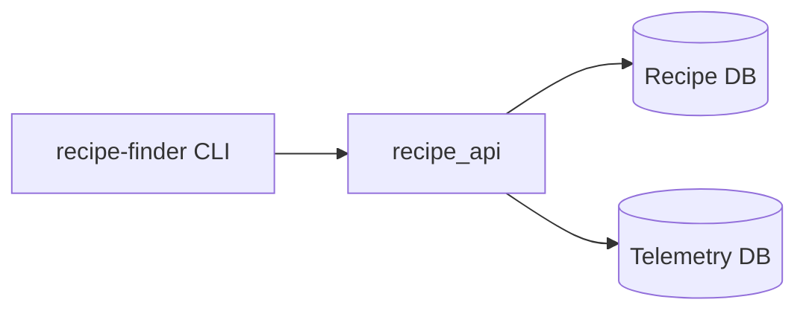

# Recipe Finder

Recipe Finder is an interactive terminal application. Enter ingredients and nutrition targets, then browse matching recipes one at a time.


The terminal client does not connect to either database. It calls the FastAPI service, while the service reads the Recipe DB and writes optional telemetry.



## Requirements

- Python 3.12
- [`uv`](https://docs.astral.sh/uv/)
- A running Recipe Finder API for real searches

## Install

```powershell
uv sync --extra server --group dev
```

For a client-only install, omit `--extra server --group dev`.

## Run

```powershell
uv run recipe-finder
```

Useful options:

```text
--lang TEXT       Start in a language, such as en or tr
--no-color        Disable terminal colors
--version         Print the installed version
```

Set the API address with `RECIPE_FINDER_API_URL`. If it is not set, the client uses `http://127.0.0.1:8000`.

## Development

```powershell
uv run ruff check .
uv run ruff format .
uv run ty check .
uv run pytest -m "not integration"
```

## Project documentation

- [Design](docs/DESIGN.md): screens, keyboard controls, and user-facing behavior
- [Architecture](docs/ARCHITECTURE.md): components, APIs, and data flow
- [Database](docs/DB.md): schemas, constraints, and database rules

The API and database setup scripts are in `src/recipe_api/` and `db/` and `tools/`.
