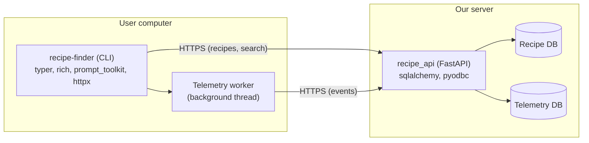
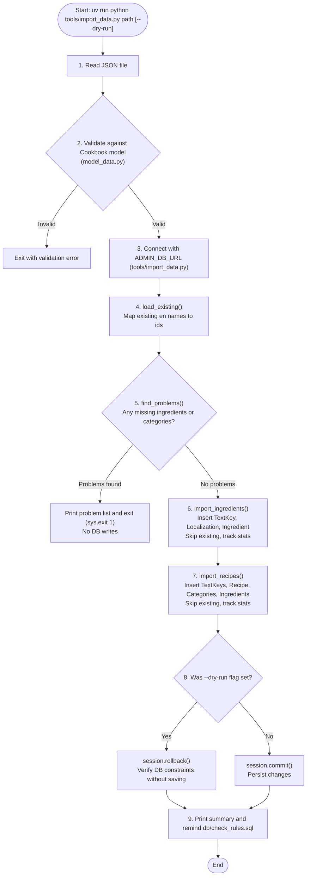

# This file explains how `recipe-finder` is built: the tech stack, the file structure, and how the main algorithms work.

---

## 1. Goal

`recipe-finder` is a terminal tool. The user gives ingredients and minimum nutrition values. The tool shows matching recipes, one at a time.

Users install the tool on their own computer. The databases stay on **our** server. So the tool must never hold a database password. For this reason, the tool talks to a small **API**. Only the API talks to the databases.

---

## 2. Big Picture



Why an API:

- No database password on the user computer.
- Users do not need to install an ODBC driver.
- We can change the database without a new CLI release.
- We can add limits (rate limit, size limit) in one place.

---

## 3. Tech Stack

Language: Python (the version is in `.python-version`). Package manager: `uv`.

### 3.1 CLI packages (runs on the user computer)

| Package          | Job                                                                |
| ---------------- | ------------------------------------------------------------------ |
| `typer`          | Starts the tool. Reads flags: `--lang`, `--no-color`, `--version`. |
| `rich`           | Draws the screens: boxes, colors, nutrition bars.                  |
| `prompt_toolkit` | Reads the keys. Gives menus, autocomplete, and Left/Right keys.    |
| `httpx`          | Calls the API.                                                     |
| `pydantic`       | Checks the data that comes from the API.                           |
| `platformdirs`   | Finds the right config folder on each system.                      |

### 3.2 API packages (runs on our server)

| Package             | Job                                        |
| ------------------- | ------------------------------------------ |
| `fastapi`           | The API framework.                         |
| `uvicorn`           | Runs the API.                              |
| `sqlalchemy`        | Builds and runs the SQL queries.           |
| `pyodbc`            | Connects to SQL Server.                    |
| `pydantic-settings` | Reads settings from environment variables. |

### 3.3 Dev packages

| Package                | Job                         |
| ---------------------- | --------------------------- |
| `pytest`, `pytest-cov` | Tests and coverage.         |
| `respx`                | Fakes the API in CLI tests. |
| `ruff`                 | Lint and format.            |
| `ty`                   | Type checking.              |

---

## 4. File Structure

The project has two packages in `src/`: the CLI (`recipe_finder`) and the API (`recipe_api`). Each folder and file has one clear job. The comment after `#` says what it is for.

```
recipe_finder/                       # Project root
│
│
├── docs/                            # Project documents
│   ├── AGENT.md                     # Rules for AI agents that write code
│   ├── ARCHITECTURE.md              # This file: tech stack, structure, algorithms
│   ├── DB.md                        # Database schema and constraints
│   ├── DESIGN.md                    # How the CLI looks and works for the user
│   └── ROADMAP.md                   # Work phases and what to build next
│
├── src/                             # All source code
│   │
│   ├── recipe_finder/               # CLI package (runs on the user computer)
│   │   ├── __init__.py              # Package marker and app version
│   │   ├── __main__.py              # Lets the tool run with `python -m recipe_finder`
│   │   ├── cli.py                   # Entry point: reads flags, checks the terminal, starts the app
│   │   ├── app.py                   # Main loop: moves from one screen to the next
│   │   ├── cache.py                 # Ingredient cache implementation
│   │   ├── config.py                # API URL, saved language, color mode, timeouts
│   │   ├── api_client.py            # One function per API call, with error handling
│   │   ├── telemetry.py             # Event queue and background worker that sends events
│   │   ├── schemas.py               # Data models shared with the API (the only shared code)
│   │   ├── state.py                 # SearchCriteria (user choices) and ResultQueue (result list)
│   │   ├── theme.py                 # Color palette for each terminal level
│   │   ├── terminal.py              # Terminal checks: interactive, UTF-8, colors, size
│   │   │
│   │   ├── screens/                 # One file for each screen the user sees
│   │   │   ├── __init__.py          # Package marker
│   │   │   ├── main_menu.py         # Main menu: Search, Change language, Exit
│   │   │   ├── language.py          # Language selection list
│   │   │   ├── wizard.py            # Search wizard: ingredients, nutrition, category, review
│   │   │   ├── recipe_view.py       # Recipe view: one recipe at a time, Next and Previous
│   │   │   └── notices.py           # Error, no-results, and end-of-results screens
│   │   │
│   │   └── locales/                 # UI texts (menus, hints, errors), not recipe texts
│   │       ├── en.json              # English texts
│   │       └── tr.json              # Turkish texts
│   │
│   └── recipe_api/                  # API package (runs on our server)
│       ├── __init__.py              # Package marker
│       ├── main.py                  # Creates the FastAPI app and adds the routers
│       ├── settings.py              # Reads environment variables (database URLs, limits)
│       ├── database.py              # Two SQLAlchemy engines: Recipe DB and Telemetry DB
│       ├── models_recipe.py         # Table models for recipe data
│       ├── models_telemetry.py      # Table models for telemetry data
│       │
│       ├── routers/                 # HTTP layer: take the request, check input, call a query
│       │   ├── lookup.py            # /languages, /categories, /ingredients, /ingredients/suggest
│       │   ├── recipes.py           # /search, /recipes/{id}
│       │   └── telemetry.py         # /sessions, /events
│       │
│       └── queries/                 # Data layer: all SQL, written with SQLAlchemy expressions
│           ├── lookup.py            # Languages, categories, ingredient suggestions
│           ├── search.py            # Recipe search with filters and sorting
│           ├── recipes.py           # Load one full recipe with language fallback
│           ├── telemetry.py         # Session and event tracking
│           └── nutrition.py         # The one nutrition formula used by search and recipe detail
│
├── db/                              # SQL scripts for both databases (run in SSMS or CI)
│   ├── schema_recipe.sql            # Creates the Recipe DB tables and constraints (see DB.md)
│   ├── schema_telemetry.sql         # Creates the Telemetry DB tables and constraints (see DB.md)
│   ├── seed.sql                     # Sample data for development and tests
│   ├── check_rules.sql              # Checks the application rules that SQL cannot enforce (see DB.md)
│   └── accounts.sql                 # Creates permissions and roles for database access
│
├── data/                            # Raw JSON files used for importing recipes
│   ├── data.json                    # Main recipe dataset
│   └── data_ex.json                 # Example dataset for testing and format reference
│
├── tools/                           # Offline database maintenance and data import tools
│   ├── __init__.py                  # Package marker
│   ├── model_data.py                # Pydantic schemas validating input JSON structure
│   └── import_data.py               # CLI tool to validate and import data into Recipe DB
│
├── tests/                           # All tests
│   ├── conftest.py                  # Shared fixtures and test data
│   ├── cli/                         # CLI tests (API faked with respx)
│   └── integration/                 # API and query tests on a real SQL Server (local)
│
├── .env_example                     # Names of environment variables with fake values
├── .gitignore                       # Files Git must ignore (for example the real .env)
├── .python-version                  # Python version for uv
├── LICENSE.txt                      # License
├── pyproject.toml                   # Project settings, packages, tool config
├── README.md                        # Short intro: what it is, how to install and run
└── uv.lock                          # Locked package versions
```

Rules:

- `recipe_finder` never imports `sqlalchemy` or `pyodbc`.
- `recipe_api` never imports `typer`, `rich`, or `prompt_toolkit`.
- The only code both sides share is `recipe_finder/schemas.py`.
- `tools/import_data.py` is an offline admin tool that accesses Recipe DB directly using `ADMIN_DB_URL`; it is never called by the API or CLI.

---

## 5. What Each Part Does

### 5.1 CLI

| File             | Job                                                                                                          |
| ---------------- | ------------------------------------------------------------------------------------------------------------ |
| `cli.py`         | Reads the flags, checks that the terminal is interactive, calls `app.run()`.                                 |
| `app.py`         | Holds the main loop. Moves from one screen to the next.                                                      |
| `config.py`      | Gives the API URL, the saved language, and the color mode.                                                   |
| `api_client.py`  | One function per API call. Sets timeouts and sends `X-App-Version` plus the current session header. Turns HTTP errors into `ApiClientError`. |
| `telemetry.py`   | `track(event_type, data)` records an in-memory event and queues it for a background worker.                |
| `state.py`       | `SearchCriteria` (what the user chose) and `ResultQueue` (the recipe ids and the current place).             |
| `theme.py`       | Color names for every terminal level (truecolor, 256, 16, none).                                             |
| `terminal.py`    | Checks the terminal: interactive, UTF-8 support, color level, and size.                                      |
| `schemas.py`     | Data models for API requests and answers. The only code shared with the API.                                 |
| `screens/*`      | Each screen draws with `rich`, then reads keys with `prompt_toolkit`. A screen returns the next screen name. |
| `locales/*.json` | Texts of menus, hints, and errors.                                                                           |

### 5.2 API

| File                   | Job                                                                                                   |
| ---------------------- | ----------------------------------------------------------------------------------------------------- |
| `main.py`              | Creates the app and adds the routers.                                                                 |
| `settings.py`          | Reads `RECIPE_DB_URL` and `TELEMETRY_DB_URL`.                                                         |
| `database.py`          | Two SQLAlchemy engines. One for each database.                                                        |
| `models_recipe.py`     | The tables from `DB.md`.                                                                              |
| `models_telemetry.py`  | The tables from `DB.md`.                                                                              |
| `routers/*`            | Take the HTTP request, check the input, call a query function.                                        |
| `queries/*`        | All recipe and telemetry queries, written with SQLAlchemy expressions and handled errors.               |
| `queries/nutrition.py` | The one nutrition formula. Search and recipe detail both use it, so the numbers always match.         |

### 5.3 Tools and Data

| File                   | Job                                                                                    |
| ---------------------- | -------------------------------------------------------------------------------------- |
| `data/*.json`          | Raw recipe and ingredient datasets in JSON format.                                     |
| `tools/model_data.py`  | Pydantic strict models checking nutrition sanity, categories, and uniqueness.          |
| `tools/import_data.py` | CLI script to validate dependencies, skip existing records, and import into Recipe DB. |

---

## 6. API Endpoints

All data is JSON. The CLI sends two headers on every call: `X-App-Version` and `X-Session-Id` (when known).

| Method and path                                    | Job                                       |
| -------------------------------------------------- | ----------------------------------------- |
| `GET /languages`                                   | All languages.                            |
| `GET /categories?lang=en`                          | All categories, named in the language.    |
| `GET /ingredients?lang=en`                         | All ingredients for the client autocomplete cache. |
| `GET /ingredients/suggest?q=chick&lang=en&limit=8` | Ingredients whose name contains the text. |
| `POST /search`                                     | Returns the ordered list of recipe ids.   |
| `GET /recipes/{id}?lang=en`                        | One full recipe.                          |
| `POST /sessions`                                   | Starts a session. Returns `session_id`.   |
| `PATCH /sessions/{id}`                             | Sets `language_code` or `ended_at`.       |
| `POST /events`                                     | Saves one telemetry event.                |

`POST /search` body:

```json
{
    "lang": "en",
    "ingredient_ids": [4, 9],
    "max_calorie": 600,
    "min_protein": 30,
    "min_carbohydrate": 40,
    "min_fat": null,
    "min_fiber": null,
    "min_sugar": null,
    "min_sodium": null,
    "category_id": 3
}
```

Response: `{"recipe_ids": [12, 7, 31], "total": 3}`

Fields that are `null` are not used as filters.

---

## 7. Algorithms

### 7.1 Start

1. `cli.py` reads the flags.
2. If the terminal is not interactive, print the error and exit with code 1.
3. Choose the language: `--lang` first, then the saved language, then `en`.
4. Verify the API with `GET /languages`. If this fails, show the error screen (`Retry` / `Main menu`).
5. Start the telemetry worker. Its first request is `POST /sessions`; telemetry remains best-effort.
6. Show the main menu.

### 7.2 Main loop

`app.py` keeps one variable: the name of the current screen. Each screen function runs and returns the name of the next screen. The loop ends when a screen returns `exit`. On exit, the telemetry worker closes its session, even after `Ctrl+C`.

### 7.3 Ingredient suggest (the user may type an incomplete name)

On the client:

1. At search start, call `GET /ingredients?lang=<lang>` and save the response in the per-language local cache.
2. The cache is stored below the platform user cache directory and is fresh for 48 hours.
3. While the user types, search the local trie for prefix matches, then append case-insensitive substring matches until the limit of eight suggestions.
4. The selected suggestion is converted to an ingredient id. The search request uses ids, not the typed text.

On the server:

1. Take the `Localization` rows for the ingredient names in the chosen language, with an `en` fallback.
2. Keep rows whose name contains the text, ignoring case.
3. Rows that start with the text come first. Then sort by name and return at most `limit` rows.

The CLI currently uses the cached `/ingredients` list for interactive autocomplete; `/ingredients/suggest` remains available for direct API consumers.

### 7.4 Search (server)

Input: the body from section 6.

1. Check the input. All numbers must be 0 or more. If not, return an error.
2. For every recipe, calculate:
    - for each nutrient: `SUM(ingredient_quantity / 100.0 * nutrient_per_100g)` over its `Recipe_Ingredients` rows
    - `ingredient_count`: how many ingredients the recipe has
    - `matched_count`: how many of those ingredients are in the user's `ingredient_ids`
3. Add one condition for each filter the user set:
    - `calorie <= max_calorie`
    - `protein >= min_protein`, and the same for carbohydrate, fat, fiber, sugar, sodium
    - the recipe has the chosen category (check in `Recipe_Categories`)
    - if `ingredient_ids` is not empty: `matched_count >= 1`
4. Sort:
    1. `matched_count` high to low (recipes with more of the user's ingredients first)
    2. `ingredient_count - matched_count` low to high (fewer extra ingredients first)
    3. `recipe_id` low to high (so the order is always the same)
5. Keep the first `SEARCH_LIMIT` ids (default 100). Return them with `total` (the real count).

Sketch (only the idea, the real code uses SQLAlchemy expressions):

```sql
WITH totals AS (
    SELECT ri.recipe_id,
           SUM(ri.ingredient_quantity / 100.0 * i.ingredient_calorie) AS calorie,
           SUM(ri.ingredient_quantity / 100.0 * i.ingredient_protein) AS protein,
           -- ... the same for carbohydrate, fat, fiber, sugar, sodium
           COUNT(*) AS ingredient_count,
           SUM(CASE WHEN ri.ingredient_id IN (:ids) THEN 1 ELSE 0 END) AS matched_count
    FROM Recipe_Ingredients ri
    JOIN Ingredients i ON i.ingredient_id = ri.ingredient_id
    GROUP BY ri.recipe_id
)
SELECT TOP (100) t.recipe_id
FROM totals t
WHERE t.calorie <= :max_calorie          -- only if set
  AND t.protein >= :min_protein          -- only if set
  AND t.matched_count >= 1               -- only if ingredients were given
  AND EXISTS (SELECT 1 FROM Recipe_Categories rc
              WHERE rc.recipe_id = t.recipe_id AND rc.category_id = :category_id)
ORDER BY t.matched_count DESC,
         t.ingredient_count - t.matched_count ASC,
         t.recipe_id ASC;
```

Note: the nutrition is calculated on every search. If the data grows and this gets slow, add an indexed view or a cache. Do this only when it is really slow.

### 7.5 Search (client)

1. The review screen builds `SearchCriteria` from the answers.
2. `track("search_executed", ...)`.
3. Call `POST /search`.
4. If the list is empty: `track("no_results", ...)` and show the no-results screen.
5. If not: make a `ResultQueue(recipe_ids)` with `index = 0` and open the recipe view.

### 7.6 Recipe view

`ResultQueue` keeps the ids, the current `index`, and a set called `skipped_ids`.

Show the recipe at `index`:

1. If the recipe is not in the local cache, call `GET /recipes/{id}`. Save it in the cache.
2. In the background, load the next recipe into the cache. Then `Next` feels instant.
3. Draw the recipe. For every ingredient, write `[have]` if its id is in the user's `ingredient_ids`, and `[need]` if not.

Keys:

| Key              | What happens                                                                                                                                                     |
| ---------------- | ---------------------------------------------------------------------------------------------------------------------------------------------------------------- |
| `Next`           | If this id is not in `skipped_ids`: add it and `track("recipe_skipped", ...)`. If this is the last recipe, show the end-of-results screen. If not, `index += 1`. |
| `Previous`       | If `index > 0`: `index -= 1`. No event.                                                                                                                          |
| `Choose` (Enter) | `track("recipe_clicked", ...)`. Keep the selected recipe on screen with a confirmation message until `Esc`.                                                        |
| `Esc`            | Go to the main menu. No event.                                                                                                                                   |

`position` in the event data is `index + 1`. `total` is the length of the list.

### 7.7 Language

- Every API call that returns localized names gets `lang`.
- Recipe, category, detail, and suggestion queries use a fallback: first the row in the chosen language, then the row in `en`. The `/ingredients` cache endpoint returns rows for the requested language.
- On the client, when the user picks a new language:
    1. Save it to the config file.
    2. Reload the UI texts.
    3. Clear the ingredient cache so autocomplete names are loaded in the new language. Recipe detail caching is scoped to one recipe-view session.
    4. `track("language_changed", ...)` and `PATCH /sessions/{id}`.

### 7.8 Telemetry

Client side:

1. `track()` records the event in memory, puts `(event_type, event_data)` into a queue, and returns at once. It never raises an error.
2. One worker thread reads the queue. First it creates the session (`POST /sessions`) and keeps the `session_id`. If session creation fails, queued events cannot be sent.
3. For each event, the worker calls `POST /events` with a short timeout (2 seconds). If the call fails, the event is dropped.
4. If 3 calls fail one after another, the worker turns telemetry off for the rest of this run.
5. On exit, put a stop marker in the queue. Wait at most 2 seconds for the worker. The worker calls `PATCH /sessions/{id}` with `ended_at` before it stops.
6. If the tool crashes, `ended_at` stays empty. This is on purpose (see `DB.md`).

Server side:

1. Check that `event_type` is one of the 11 allowed values and `event_data` is a JSON object.
2. Insert into the Telemetry DB. If this fails, return an error. The client ignores it.
3. The server also writes the database events. For every request that has an `X-Session-Id`:
    - `db_query_completed` or `db_query_failed` after each Recipe DB query, with the time it took.
    - `db_connection_opened` the first time that session uses the Recipe DB successfully.
    - `db_connection_failed` when the Recipe DB cannot be reached.
      The server keeps the list of "already opened" session ids in memory with a size limit.

Who sends which event:

| Event                                                                                                             | Sent by |
| ----------------------------------------------------------------------------------------------------------------- | ------- |
| `search_executed`, `no_results`, `recipe_clicked`, `recipe_skipped`, `invalid_input`, `language_changed`, `error` | CLI     |
| `db_connection_opened`, `db_connection_failed`, `db_query_completed`, `db_query_failed`                           | API     |

If the CLI cannot reach the API at all, the Telemetry DB is also not reachable, so there is no event. The user sees the error screen only.

---

## 8. Settings

### CLI (`config.py`)

| Setting  | Where it comes from                                                                            |
| -------- | ---------------------------------------------------------------------------------------------- |
| API URL  | Environment variable `RECIPE_FINDER_API_URL`. If missing, `http://127.0.0.1:8000`.             |
| Language | `--lang`, then `config.json` in the user config folder (found with `platformdirs`), then `en`. |
| Colors   | `--no-color` or `NO_COLOR`, then terminal detection (see `DESIGN.md`).                         |
| Timeouts | API calls: 3 s connect, 10 s read. Telemetry: 2 s.                                             |

The CLI has **no secrets**.

### API (`settings.py`)

| Environment variable | Meaning                                                                                                         |
| -------------------- | --------------------------------------------------------------------------------------------------------------- |
| `RECIPE_DB_URL`      | Required SQLAlchemy connection string for the Recipe DB.                                                        |
| `TELEMETRY_DB_URL`   | Required SQLAlchemy connection string for the Telemetry DB.                                                     |
| `SEARCH_LIMIT`       | Maximum ids returned in one search. Default 100; must be at least 1.                                            |

### Import Tool (`tools/import_data.py`)

| Environment variable | Meaning                                                                                     |
| -------------------- | ------------------------------------------------------------------------------------------- |
| `ADMIN_DB_URL`       | Connection string for Recipe DB with admin privileges (write access, never exposed to API). |

`.env_example` shows these names with fake values. The real `.env` is never committed.

---

## 9. Errors

| Problem                                | What the CLI does                                                     |
| -------------------------------------- | --------------------------------------------------------------------- |
| API cannot be reached, timeout, or 5xx | Error screen with `Retry` / `Main menu`.                              |
| 4xx from the API                       | A bug. Show the error screen. Send an `error` event.                  |
| Search returns 0 recipes               | No-results screen.                                                    |
| A recipe id cannot be loaded (404)     | Remove it from the queue. Continue with the next recipe; if the queue becomes empty, return to the main menu. |
| Telemetry call fails                   | Nothing. The user never sees it.                                      |
| `Ctrl+C`                               | Restore the terminal. Close the session (7.8). Exit with code 130.    |

The API never sends technical error text to the CLI. It sends a short code (for example `db_unavailable`). The CLI maps the code to a text in `locales/`.

---

## 10. Security

- The databases should not be reachable from the internet; only the API deployment should reach them.
- HTTPS is a deployment requirement and is not configured by this application.
- The Recipe DB account can only read. The Telemetry DB account can only insert events and update sessions.
- All SQL uses bound parameters (SQLAlchemy). Never build SQL from text.
- Rate limiting is not implemented. Request validation and the 64 KiB body limit are the current API safeguards.
- The API rejects request bodies over 64 KiB with `413` and the code `payload_too_large` (`BodySizeLimitMiddleware` in `main.py`). It also counts the bytes of chunked bodies that have no `Content-Length`.
- The tool does not save what the user types. Events keep only counts, field names, and ids.
- Anyone can call a public API, so treat all input as unsafe. The API checks every field.

---

## 11. Testing and CI

| Kind              | Where                | What it checks                                                                                                                                                       |
| ----------------- | -------------------- | -------------------------------------------------------------------------------------------------------------------------------------------------------------------- |
| CLI tests         | `tests/cli/`         | Screen flow, `ResultQueue`, the skip-once rule, telemetry worker. The API is faked with `respx`.                                                                     |
| Integration tests | `tests/integration/` | Queries and endpoints (search, suggest, language fallback) on a real SQL Server. Marked `integration`. This also checks `IDENTITY`, `ISJSON`, and other CHECK rules. |

The API tests do not use SQLite. SQLite differs from SQL Server (case rules, `ISJSON`, `IDENTITY`), so a green SQLite test can still fail in production. During development, the integration tests run on the SQL Server installed on the developer computer. The test database is built from `db/schema_*.sql` and `db/seed.sql`.

No CI workflow files are present in this repository. The commands below are the local validation commands; integration tests require a configured SQL Server and the required environment variables.

---

## 12. Commands

```
uv sync                                                         # install the CLI
uv sync --extra server --group dev                              # install the API and dev tools
uv run recipe-finder                                            # run the CLI
uv run uvicorn recipe_api.main:app                              # run the API
uv run python tools/import_data.py data/data_ex.json --dry-run  # test import with rollback
uv run pytest -m "not integration"                              # fast tests
uv run pytest -m integration                                    # needs a SQL Server
```

---

## 13. Data Import Workflow

`tools/import_data.py` is an offline CLI maintenance tool used to import ingredients and recipes from JSON files in `data/` directly into `RecipeDB`. It connects with administrative privileges using `ADMIN_DB_URL`.

### 13.1 Execution Flow



### 13.2 Rules and Safety

1. **Isolation:** The tool defines a dedicated `Settings(BaseSettings)` class reading `ADMIN_DB_URL` from `.env`. The API settings (`recipe_api/settings.py`) never see or load this secret.
2. **Schema & Sanity Check:** `model_data.py` enforces strict bounds (calories <= 900, macronutrient sums <= 100 g per 100 g) and forbids duplicates.
3. **Pre-flight Dependency Check:** `find_problems()` verifies that every category and ingredient referenced by incoming recipes either already exists in `RecipeDB` or is defined in the same file. If any dependency is missing, it lists all issues and terminates immediately before performing any database inserts.
4. **Idempotent Imports:** Ingredients and recipes that already exist in `RecipeDB` (matched case-insensitively by English name) are skipped. Newly inserted items are immediately registered in the in-memory lookup map so subsequent recipes in the same batch can reference them.
5. **Dry Run:** Passing `--dry-run` executes all inserts and flushes through the transaction to validate foreign keys, unique constraints, and check constraints, but issues a `rollback()` at the end to guarantee zero persistent changes.
