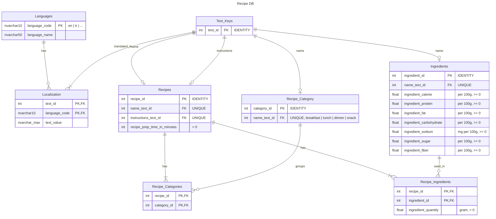
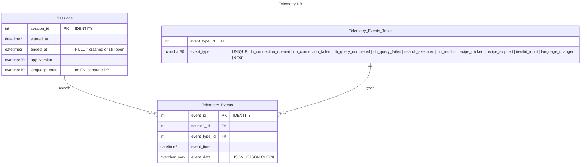

# This file specifies the database schema for the Recipe Finder application.

## Entity-Relationship Diagram





---

## Relational Model

**Recipe DB**

```
Languages(language_code PK, language_name)

Text_Keys(text_id PK)

Localization(text_id PK/FK → Text_Keys, language_code PK/FK → Languages, text_value)

Recipes(recipe_id PK, name_text_id FK → Text_Keys, instructions_text_id FK → Text_Keys, recipe_prep_time_in_minutes)

Recipe_Category(category_id PK, name_text_id FK → Text_Keys)

Recipe_Categories(recipe_id PK/FK → Recipes, category_id PK/FK → Recipe_Category)

Ingredients(ingredient_id PK, name_text_id FK → Text_Keys, ingredient_calorie, ingredient_protein, ingredient_fat, ingredient_carbohydrate, ingredient_sodium, ingredient_sugar, ingredient_fiber)

Recipe_Ingredients(recipe_id PK/FK → Recipes, ingredient_id PK/FK → Ingredients, ingredient_quantity)
```

**Telemetry DB**

```
Sessions(session_id PK, started_at, ended_at, app_version, language_code)

Telemetry_Events_Table(event_type_id PK, event_type)

Telemetry_Events(event_id PK, session_id FK → Sessions, event_type_id FK → Telemetry_Events_Table, event_time, event_data)
```

---

## Constraints

- **UNIQUE:** These columns must be unique:
    - `Recipes.name_text_id`
    - `Recipes.instructions_text_id`
    - `Recipe_Category.name_text_id`
    - `Ingredients.name_text_id`
- **CHECK on `Recipes`:** `name_text_id <> instructions_text_id`. A recipe cannot use the same text key for name and instructions.
- **CHECK on numbers:**
    - `Recipes.recipe_prep_time_in_minutes > 0`
    - `Ingredients.ingredient_*` columns `>= 0`
    - `Recipe_Ingredients.ingredient_quantity > 0`
- **Composite PK:** A recipe cannot have the same category twice. A recipe cannot have the same ingredient twice.
- **UNIQUE:** `Telemetry_Events_Table.event_type`.
- **Allowed event types:** `Telemetry_Events_Table` holds the 11 allowed values, and `Telemetry_Events.event_type_id` is a FK to it. The 11 values are `db_connection_opened`, `db_connection_failed`, `db_query_completed`, `db_query_failed`, `search_executed`, `no_results`, `recipe_clicked`, `recipe_skipped`, `invalid_input`, `language_changed`, `error`. The table is filled when the database is created (see `db/`).
- **CHECK on `event_data`:** The value must be valid JSON (`ISJSON(event_data) = 1`).
- **No FK on `Sessions.language_code`:** The two databases are separate.
- **NULL allowed:** Only `Sessions.ended_at`.
- **NOT NULL:** All other columns, including `Telemetry_Events.event_data`.

_**Application Rules**_

SQL Server cannot enforce these rules. The application must check them:

- A recipe must have at least 1 category (`Recipes ||--|{ Recipe_Categories`).
- A recipe must have at least 1 ingredient (`Recipes ||--|{ Recipe_Ingredients`).
- A text key should be used in only one place (for example, not as a recipe name and an ingredient name at the same time).
- Every text key should have a translation for each active language.
- Telemetry must never stop the application. If the Telemetry DB fails, the event is lost.
