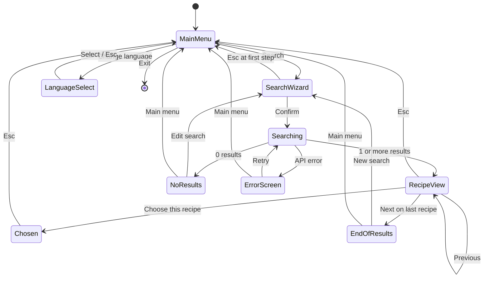

# This file describes how the `recipe-finder` terminal tool looks and works for the user.

---

## 1. Purpose

`recipe-finder` is an interactive terminal tool.

The user enters the ingredients they have and the nutrition they want. The tool shows matching recipes, one at a time.

**Rules**

- The user interacts with the keyboard. Arrow keys, `Enter`, and `Esc` are available everywhere; letter shortcuts and editing keys are used where appropriate.
- The tool shows one recipe at a time. The user can press `Next` to see another one.
- Telemetry never stops the tool. If telemetry fails, the user sees nothing.
- No emoji anywhere in the tool.

---

## 2. Start

```
$ recipe-finder
```

The tool checks the API, starts a best-effort telemetry session, and shows the main menu. The default language is `en`.

| Flag            | Meaning                               |
| --------------- | ------------------------------------- |
| `--lang <code>` | Start in a language (`en`, `tr`, ...) |
| `--version`     | Show the app version and exit         |

---

## 3. Screen Flow



---

## 4. Screens

### 4.1 Main Menu

```
  ╭──────────────────────────────────────────╮
  │  Recipe Finder                           │
  │  Find a recipe with what you have.       │
  ╰──────────────────────────────────────────╯

    > Search
      Change language
      Exit

  Up/Down move   Enter select   Ctrl+C quit
```

- There are three items: **Search**, **Change language**, **Exit**.
- The selected item has the accent color and the `>` mark.
- Down on the last item goes to the first item.

### 4.2 Language Select

- The list shows every language returned by the API: `language_name (language_code)`.
- The current language has a `*` mark.
- When the user selects a language, the screen changes language at once. The tool sends a `language_changed` event and goes back to the main menu.
- `Esc` goes back without a change.

### 4.3 Search Wizard

The wizard asks a few questions, one step at a time. The top line shows the step (`Step 2/3`).

- `Esc` goes back one step. On step 1, `Esc` goes to the main menu.
- Every step is optional. The user can press `Enter` on an empty answer to skip it.
- The user must fill in at least one thing before the search starts.

**Step 1 - Ingredients ("What do you have?")**

- At search start, the tool loads all ingredient names for the current language into a local cache. The cache is reused for 48 hours.
- The user types an ingredient name. Prefix matches are shown first, followed by case-insensitive substring matches. For example, `chick` shows `chicken breast`, `chicken thigh`, and so on.
- If the requested-language list is unavailable, an older cache can be used; with no cache, the wizard has no suggestions.
- `Tab` or `Enter` adds the highlighted suggestion. It becomes a chip: `[chicken breast] [rice] [onion]`.
- `Backspace` on an empty input removes the last chip.
- `Enter` on an empty input goes to the next step.
- If nothing matches, the tool shows "No ingredient found" and sends an `invalid_input` event.

The search shows recipes that contain the chosen ingredients. The recipe can also have other ingredients.

**Step 2 - Nutrition**

The user picks which values to set. Use `Space` to select, `Enter` to continue. Then the user types one number for each selected value.

| Value        | Type    | Unit |
| ------------ | ------- | ---- |
| Calories     | Maximum | kcal |
| Protein      | Minimum | g    |
| Carbohydrate | Minimum | g    |
| Fat          | Minimum | g    |
| Fiber        | Minimum | g    |
| Sugar        | Minimum | g    |
| Sodium       | Minimum | mg   |

- Example: `Protein min 30 g`, `Calories max 600 kcal`.
- The number must be 0 or more. If not, the tool shows an error next to the input and sends an `invalid_input` event.
- There are no ranges. The user gives only one number for each value.

**Step 3 - Category**

- The user picks one category (for example breakfast, lunch, dinner, snack) or `Any`.
- `Any` is the default.

**Review screen**

```
  Your search
  -------------------------------------
  Ingredients   chicken breast, rice
  Calories      max 600 kcal
  Protein       min 30 g
  Carbohydrate  min 40 g
  Category      Dinner
  -------------------------------------
    > Search
      Edit
      Cancel
```

When the user selects `Search`, the tool sends a `search_executed` event containing ingredient/category presence and count, then starts the search.

### 4.4 Recipe View (results)

The tool shows the first matching recipe at once. The recipes wait in a list. `Next` shows the next one.

```
  Chicken Rice Bowl                          2 / 7
  ---------------------------------------------------
  Prep time: 25 min     Category: Dinner, Lunch

  Nutrition (whole recipe)
  Calories       612 kcal
  Protein   ████████████░░░░░░░░   42 g
  Carbs     ██████████░░░░░░░░░░   58 g
  Fat       █████░░░░░░░░░░░░░░░   18 g
  Fiber     ███░░░░░░░░░░░░░░░░░    6 g
  Sugar     ██░░░░░░░░░░░░░░░░░░    5 g
  Sodium    ███░░░░░░░░░░░░░░░░░  480 mg

  Ingredients
  [have]  Chicken breast    200 g
  [have]  Rice              150 g
  [need]  Soy sauce          15 g

  Instructions
  1. ...
  2. ...

  Left Prev   Right Next   Enter Choose   Esc Menu
```

- The top line shows the recipe name and the place in the list (`2 / 7`).
- `[have]` means the user entered this ingredient. `[need]` means the user did not enter it.
- The values that match the user's filters have the success color.
- For long instructions, the user scrolls with `Up/Down` or `PgUp/PgDn`. The bottom line stays in place.
- **Next** (`Right` or `n`): sends a `recipe_skipped` event and shows the next recipe.
- **Previous** (`Left` or `p`): shows the last recipe again. No event is sent.
- **Choose** (`Enter`): sends a `recipe_clicked` event and keeps the selected recipe on screen with a short confirmation message. Navigation is paused until the user presses `Esc`.
- **Esc**: goes to the main menu. No event is sent.

### 4.5 End of Results

```
  This was the last recipe for this search.

    > New search
      Main menu
```

### 4.6 No Results

The tool sends a `no_results` event containing the current language. It shows a short message and offers `Edit search` or `Main menu`.

```
    > Edit search
      Main menu
```

### 4.7 Error Screen

- The tool shows a short, clear message in the error color. It does not show technical error text.
- The user can choose `Retry` or `Main menu`.
- The user never sees telemetry errors.

---

## 5. Key Bindings

| Key                          | Action                                            |
| ---------------------------- | ------------------------------------------------- |
| `Up` / `Down` (`k` / `j`)    | Move the selection                                |
| `Left` / `Right` (`p` / `n`) | Previous / Next recipe (Recipe View only)         |
| `Enter`                      | Confirm, select, or choose                        |
| `Space`                      | Select or unselect (multi-select lists)           |
| `Tab`                        | Accept the highlighted suggestion                 |
| `Esc`                        | Go back one step, or to the main menu             |
| `PgUp` / `PgDn`              | Scroll long text                                  |
| `Ctrl+C`                     | Quit from any screen. The session closes cleanly. |

The bottom line always shows the keys for the current screen.

---

## 6. Telemetry Mapping

All events go to the Telemetry DB with the current `session_id`. Sending does not wait. If sending fails, the event is lost and the user sees nothing.

| Event                  | When                                 | `event_data` (JSON)                                                                    |
| ---------------------- | ------------------------------------ | -------------------------------------------------------------------------------------- |
| `db_connection_opened` | Recipe DB connected                  | `{"duration_ms": 42}`                                                                  |
| `db_connection_failed` | Recipe DB connection failed          | `{"error": "timeout"}`                                                                 |
| `db_query_completed`   | A query worked                       | `{"query": "search", "duration_ms": 18, "rows": 7}`                                    |
| `db_query_failed`      | A query failed                       | `{"query": "search", "error": "..."}`                                                  |
| `search_executed`      | User confirms the review screen      | `{"has_ingredients": true, "ingredient_count": 2, "has_category": true}`             |
| `no_results`           | The search found 0 recipes           | `{"lang": "en"}`                                                                       |
| `recipe_clicked`       | User presses Choose                  | `{"recipe_id": 12, "position": 2, "total": 7}`                                         |
| `recipe_skipped`       | User presses Next                    | `{"recipe_id": 12, "position": 2, "total": 7}`                                         |
| `invalid_input`        | An answer in the wizard is not valid | `{"step": "nutrition", "field": "protein"}`                                            |
| `language_changed`     | User changes the language            | `{"from": "en", "to": "tr"}`                                                           |
| `error`                | An API/search error happens          | `{"error_code": "search_failed"}`                                                      |

Rules:

- Do not save the text the user typed. Save only counts, field names, and IDs.
- In one search, the tool sends `recipe_skipped` only once for each recipe. If the user goes back with `Previous` and presses `Next` again, no new event is sent.
- When the tool starts, it adds a row to `Sessions`. When the user exits (also with `Ctrl+C`), the tool sets `ended_at`. If the tool crashes, `ended_at` stays empty. This is on purpose.

---

## 7. Color Palette - "Tomato & Slate"

The palette is for dark terminals. The tool does not set a background color. It uses the background of the terminal, so it works with any theme. Warm colors give a food feeling. Cool gray colors make the text easy to read.

### 7.1 Main Colors

| Name           | Hex                | ANSI-256 | 16-color     | Used for                                 |
| -------------- | ------------------ | -------- | ------------ | ---------------------------------------- |
| `accent`       | `#FF6B5A` Tomato   | 203      | bright red   | Selected item, `>` mark, titles          |
| `success`      | `#6FCF97` Basil    | 78       | green        | `[have]`, matching values, good messages |
| `info`         | `#6CB6FF` Sky      | 75       | bright blue  | Hints, step line                         |
| `warning`      | `#F2C14E` Saffron  | 221      | yellow       | Soft warnings, no-results hint           |
| `error`        | `#E5484D` Chili    | 167      | red          | Errors, `[need]`                         |
| `text`         | `#F2EFE9` Cream    | 255      | default      | Normal text                              |
| `muted`        | `#8B93A7` Slate    | 103      | bright black | Key hints, small labels                  |
| `border`       | `#3A3F4B` Graphite | 238      | bright black | Boxes and lines                          |
| `highlight_bg` | `#2A2F3A` Charcoal | 236      | reverse      | Background of the selected row           |

### 7.2 Nutrition Colors

Each nutrition value always has the same color.

| Value        | Hex               | ANSI-256 |
| ------------ | ----------------- | -------- |
| Calories     | `#F2EFE9` Cream   | 255      |
| Protein      | `#6CB6FF` Sky     | 75       |
| Carbohydrate | `#F2C14E` Saffron | 221      |
| Fat          | `#FF8FA3` Rose    | 211      |
| Fiber        | `#6FCF97` Basil   | 78       |
| Sugar        | `#B79CED` Lilac   | 141      |
| Sodium       | `#8B93A7` Slate   | 103      |

### 7.3 Color Rules

- Color is never the only sign. There is always a mark or a word too (`>`, `[have]`, `[need]`).
- The tool chooses colors in this order:
    1. Truecolor terminal (`COLORTERM=truecolor` or `24bit`): hex colors.
    2. 256-color terminal: ANSI-256 colors.
    3. Other terminals: 16-color names.
- One screen uses `accent` and at most one more color for meaning.
- Use `muted` only for hints and small labels. Never use it for important text.

---

## 8. Layout

- The title box has round corners (`╭ ╮ ╰ ╯`). Lines use `-` or `─`.
- If the terminal does not support UTF-8, the tool uses plain ASCII (`+`, `-`, `|`, `>`).
- Minimum width is 60 columns. The content width is the smaller of the terminal width and 80. The content has a 2-space margin on the left.
- If the terminal is narrower than 60 columns, the tool hides the bars and shows only `Label  value`.
- Each bar is relative to a daily reference value (for example 50 g for protein). A bar never goes past its full width.
- The tool runs in the terminal's alternate screen buffer for the duration of the application, then restores the previous terminal screen on exit.

---

## 9. Language

- Names of recipes, categories, ingredients, and instructions come from the API in the current language.
- Recipe, category, detail, and suggestion lookups fall back to `en` when a localization is missing. The full ingredient-cache endpoint uses the requested language rows.
- Menu texts, hints, and error messages are in language files inside the tool (`en`, `tr`), not in the database.
- The tool saves the last language in a local config file and uses it the next time.

---

## 10. Problems and Edge Cases

- The tool is not in a terminal (for example, the output is piped): the tool prints `recipe-finder needs an interactive terminal.` to stderr and exits with code 1.
- The user changes the terminal size: the tool draws the screen again.
- The API cannot be reached when the tool starts: the tool shows the error screen with `Retry` and `Main menu`. If telemetry cannot connect, the tool starts normally and shows no message.
- `Ctrl+C`: the tool restores the terminal, closes the session, and exits with code 130.
